# ReMeal: Ethical Issues in a Surplus Food App

## Group Members

| Name | Student ID |
|---|---:|
| Wong Chuek Kei | 20602511 |
| Chai Chok Yuen | 20720830 |
| Tham Wing Lok | 20611657 |
| Moiz Israr Malik | 20705922 |
| Xinzhu Yang | 20700664 |

## 1. Introduction

This proposal sets up our ethical review of ReMeal, a Malaysian app that sells surplus food from local vendors at reduced prices. ReMeal has a worthwhile aim: less food waste and cheaper meals. We ask whether an app with a good purpose can still treat its users unfairly through its design and policies. Section 2 explains our choice of system, and Section 3 describes how we are investigating it. Section 4 reviews related research. Section 5 reports four issues: privacy, refunds and cancellations, food descriptions, and allergen information. Section 6 proposes our ethical framework, and Section 8 sets out our plan for Part 2.

## 2. System Overview and Selection Rationale

### 2.1 What ReMeal Does

ReMeal is a Malaysian app developed by ReMeal Sdn. Bhd. It connects cafés, bakeries, supermarkets, and restaurants with customers who want to buy surplus food at reduced prices. Users can pay through the app and, depending on the available option, collect their order, dine in, or use delivery. In December 2024, *Vulcan Post* reported that ReMeal had 16 active stores and 1,800 user sign-ups, and described a model in which users collected food from vendors rather than receiving deliveries (Kasinathan, 2024). ReMeal’s current website also lists dine-in and delivery options, which may vary by vendor (ReMeal, n.d.-a).

### 2.2 Why We Chose ReMeal

ReMeal is a real app that is available to download, and users can investigate its features and policies. It is a small Malaysian platform rather than a global service. Our preliminary searches found press coverage and ReMeal’s own pages, but no academic studies of the app.

ReMeal also has ethically relevant features. Its App Store privacy information, which is provided by the developer, lists data such as location and purchase history as information the app may collect. The app handles payments and refunds, and users rely on vendor listings to understand what food they are buying.

We chose ReMeal because it aims to reduce food waste and make food more affordable. This raised a question we found interesting: can a well-intentioned app still treat users unfairly through the way it is designed? Surplus food also differs from ordinary food delivery. What is available depends on what vendors have left, so customers rely heavily on listings to know what they are buying. Responsibility is shared between ReMeal and independent vendors, which may make it unclear who answers for a refund, a misleading description or a missing allergen warning. The food-app research we found mainly concerns delivery platforms (e.g. Al Rezan et al., 2025), so a small surplus-food app lets us test whether their known problems appear in a different business model.

## 3. Investigation Method

### 3.1 Investigation Plan

Each issue has one owner and uses at least one first-hand method alongside reading the policies:

| Issue | Methods |
|---|---|
| Privacy and data | Privacy Notice and Terms; Android permission audit; app-store data-safety labels |
| Refunds and cancellations | Terms on order acceptance, cancellation and refunds; walkthrough of the order flow up to payment |
| Food descriptions and photos | Structured review of a sample of listings against a fixed checklist (photo, contents, quantity, price, collection time, vendor) |
| Allergens and food safety | Terms on allergens; the same listing sample checked for ingredient and allergen details |

Across all issues, we check the walkthrough for dark patterns and code public app-store reviews by theme. We follow three evidence rules. First, every screenshot is dated and numbered in the Appendix. Second, we treat developer-provided disclosures as claims, not verified facts. Third, we do not call a listing inaccurate unless we can verify it.

### 3.2 How We Examined the App and Its Policies

For the privacy review, we read ReMeal’s Privacy Notice and Terms and checked the privacy information on the app-store listings. On 2 November 2026, we walked through the Android app’s sign-in screen, location setup, location permission prompt, and notification permission prompt. We saved screenshots of the app screens and relevant policy sections for the Appendix (Figures A1–A13).

### 3.3 Evidence Collected and Limitations

Our screenshots show what the app and policies displayed on 2 November 2026. The App Store and Google Play privacy information is supplied by the developer, so it is not an independent technical audit. We did not inspect network traffic, ReMeal’s servers, or how vendors and other service providers handle data.

For location, we followed one sequence: choosing “Set From Map” brought up the Android location prompt; backing out without choosing “Allow” or “Don’t allow” led to a screen with “Use Default Location”; tapping that opened the home screen. We did not explicitly deny location access, test whether the banner returns on later launches, establish how the default location was selected, or test whether browsing and ordering work from it. A separate notification-permission prompt appeared after the home screen; we did not assess its effects.

## 4. Related Literature

### 4.1 Privacy and Personal Data in Food Delivery Apps

App privacy research covers risks and consent. Ebrahimi et al. (2021) mapped 59 software-engineering studies from 2008–2018: most focused on detecting privacy leaks, with fewer studies on privacy policies and user perspectives. Al Rezan et al. (2025) found that nine popular Malaysian food-delivery apps failed to meet the standards developed in their consumer-protection analysis. Obar and Oeldorf-Hirsch (2020) found 74% of 543 participants skipped a privacy policy for a fictitious social network; Nouwens et al. (2020) found that only 11.8% of 680 UK websites met the study’s minimum consent criteria. Together, they show policy and interface design shape consent. Acquisti et al. (2015) show privacy choices depend on context, and Keßler and McKenzie (2018) highlight the sensitivity of location data. These studies concern other services; they guide our checks, but do not prove ReMeal has the same problems.

### 4.2 Refunds and Consumer Protection

Malaysian law gives online buyers some baseline protection. The Consumer Protection (Electronic Trade Transactions) Regulations 2012, in force since 1 July 2013, require online sellers to disclose details such as price, payment methods, terms and conditions, and estimated delivery time. They also require sellers to give buyers a way to correct errors before an order is confirmed (Consumer Protection (Electronic Trade Transactions) Regulations 2012). These provisions deal with disclosure and error correction before confirmation. The summaries we reviewed do not describe a rule on refunds after an order is accepted, so ReMeal’s refund position is assessed from its own terms below. Abenoh et al. (2019) note that Malaysian food-delivery contracts fall under several laws, including the Consumer Protection Act 1999, the Sale of Goods Act 1957, the Food Act 1983 and the Electronic Commerce Act 2006. They ask how far these laws protect e-consumers in food sales. That paper is a conference contribution that poses a question and does not measure refund outcomes.

Siali et al. (2024) surveyed 310 online food-delivery users in Sarawak, mostly about GrabFood and Foodpanda. They found that the right to redress was positively but not significantly related to customer loyalty. They also note that problems such as order accuracy and miscommunication can occasionally breach consumer rights. The sample was a convenience sample, 85.5% were full-time students, and the platforms studied are large delivery services rather than a small surplus-food app. The study therefore does not show how refunds work in an app like ReMeal.

Together, these sources show that disclosure, error correction and redress are recognised consumer concerns in Malaysian food delivery. They do not tell us what ReMeal offers. We therefore use them to ask what is refundable, when, and how a customer can complain, and our conclusions rely on ReMeal’s own terms and the walkthrough described below.

### 4.3 Food Descriptions, Allergens, and Food Safety

In Malaysia, food quality and labelling are governed mainly by the Food Act 1983 and the Food Regulations 1985, and compliance is mandatory for food sold in the country. The Regulations include labelling rules that require ingredients known to cause hypersensitivity to be declared. Soon (2018) examined allergen labelling on products sold in Malaysia, including “may contain” statements, and called for clearer guidance in the country’s allergen-labelling rules. That work concerns packaged products, not app listings for restaurant or cafe food, so we do not assume the same rules or problems apply to ReMeal.

The closest evidence on allergen information in online food ordering comes from the UK. Koidis et al. (2024) for the Food Standards Agency recruited 279 people with food hypersensitivities. Thirty-six of them browsed online ordering platforms with the intention to buy. On average they rated the clarity and sufficiency of the information slightly negatively, at about −0.6 on a scale from −2 to +2. Concerns raised by survey respondents included cross-contact during preparation (20%) and outdated information (8%). In a small pilot, eleven meals ordered as free from milk, peanut or gluten were lab-tested. Most results were low, but one sausage-and-chips meal contained 2,365 mg/kg of gluten, far above the 20 mg/kg limit for gluten-free claims. The sample was small and self-selected, mostly women, and UK-based. The meals were also bought by customers who declared an allergy, which may not match how surplus-food items are ordered, so these results cannot be generalised to ReMeal.

On photos, Siali et al. (2024) draw on earlier food-delivery studies that treat food quality as including how closely the image in the app resembles the food received. We did not find peer-reviewed Malaysian studies measuring how often app photos match delivered food. This review therefore cannot say how common mismatches are. In keeping with our approach, we note what ReMeal’s listings show and do not call anything inaccurate unless it can be verified.

To see what this means in practice, we reviewed listings from two stores in the ReMeal mobile app on 1 September 2026: Dorsett Hartamas Kuala Lumpur (https://remeal.app/stores/dorsett-hartamas-kuala-lumpur) and Krem Tarik, Kota Damansara (https://remeal.app/stores/krem-tarik-kota-damansara). We took screenshots of the store pages and of two listings from each store. For each listing we recorded which details were given: contents, ingredients, price, availability, collection rules and allergen information. We also looked at what the photos show.

Food allergies can affect more than the digestive system, and severe reactions may be life-threatening (Valenta et al., 2015). Their review provides a medical basis for why customers need reliable information about ingredients and allergens when choosing food. However, it focuses on the nature and mechanisms of food allergies rather than online food ordering.

Research in Malaysia offers a related perspective on food-service practices. Tan et al. (2023) surveyed restaurant managers and servers about their food-allergy knowledge, attitudes, practices and training. They found that participants’ food-allergy knowledge was low compared with similar studies conducted in Western contexts, and that managers were generally more aware of allergy-related practices and training needs than servers. The study highlights why staff knowledge and communication may matter when customers ask about allergens.

**Table 1. Details given in the listings reviewed**

| Listing | Details given | Not stated in the listing |
|---|---|---|
| Dorsett Hartamas KL: 40% OFF Buffet Breakfast (Available Daily). RM 27.00 (was RM 45.00). https://remeal.app/stores/dorsett-hartamas-kuala-lumpur | Dine-in only, takeaway not available; advance booking allowed; “local and international dishes”, a children’s menu; kids below 5 eat free; “50 left”; availability shown as 06:30–10:00 | Names of dishes, ingredients, allergens |
| Dorsett Hartamas KL: 50% OFF Weekend Buffet Hi-tea (Saturdays). RM 79.00 (was RM 158.00). https://remeal.app/stores/dorsett-hartamas-kuala-lumpur | Dine-in only, takeaway not available; advance booking allowed but must be redeemed on the Saturday of the same week; Saturdays 13:00–17:00; “50 left”; “local favorites and international flavors” | Names of dishes, ingredients, allergens |
| Krem Tarik: Mystery Single Scoop – Eternal Series. RM 6.00 (was RM 11.00), 45% off. https://remeal.app/stores/krem-tarik-kota-damansara | “A scoop of surprise” from four named flavours (Chocolate, Vanilla, Dark Choc Mint, Popping Lime); “Contains dairy”; “3 left”; counter collection 12:00–22:00; dine-in by request in “Notes to Seller” | Which flavour the customer receives; scoop size or weight; other allergens |
| Krem Tarik: Waffle + Eternal Series. RM 8.00 (was RM 12.00), 33% off. https://remeal.app/stores/krem-tarik-kota-damansara | “One golden waffle” with a mystery scoop from the Eternal Series (same four flavours); “Contains dairy”; “1 left” | Which flavour the customer receives; what the waffle contains; other allergens |

**Findings.**

**Detail varies between stores.** The Dorsett listings describe the food in general terms only (“local and international dishes”, “a tempting spread of local favorites”) and name no dish. The Krem Tarik listings name the flavours the customer may receive, so the uncertainty of a mystery item is limited to a known range.

**Allergen information is inconsistent.** Both Krem Tarik listings state “Contains dairy”. Neither Dorsett listing mentions allergens at all, even though the breakfast listing refers to a children’s menu. We cannot tell whether “Contains dairy” is the complete list. For example, the waffle listing does not say what the waffle contains, and a waffle is usually made with ingredients such as wheat and egg. The absence of a statement in the Dorsett listings does not show that those foods contain allergens. It only means the listing does not say.

**An inconsistency in the breakfast listing.** The availability line shows 06:30–10:00, but the description says “Available daily from 6.30am – 10.30am”. The listing does not explain the difference.

**Photos.** The Dorsett photos show an arranged breakfast spread (cereal, fruit, toast, jam, bacon, eggs, juice) and a buffet display of traditional dishes and desserts. The Krem Tarik scoop photo shows an example scoop in a branded cup. Because the flavour is a mystery, it can only be an example, and the listing does not say so. The Waffle + Eternal Series photo shows a waffle with a dark topping, a scoop in a cup, and also a green drink in a clear cup with a straw. The description mentions only a waffle and a scoop, so a customer may not know whether the drink is included. We cannot tell from the screenshots whether it is styling, and we make no claim that any photo is inaccurate. Because the Dorsett listings name no dishes, we also cannot compare their photos with a list of what is served.

**Mystery items.** The mystery scoop gives no scoop size or weight. The customer pays for an item whose exact flavour and size they cannot know in advance. In return, the named flavour range is a clear form of disclosure.

**Discount framing, stock counts and sustainability figures.** All four listings show a crossed-out original price and a “left” count (50, 50, 3 and 1). The store pages also show sales and CO₂e figures (for example 5,019 kg for Dorsett and 116 kg for Krem Tarik), and the Dorsett page says the customer has “saved food from being wasted”. The listings do not say what surplus is being sold, and the screens we captured do not explain how the figures are calculated. We cannot verify the original prices, the stock counts or the environmental figures. Low counts such as “1 left” may also create a sense of urgency.

**Clear practical conditions.** Both stores state how the item is received: dine-in only with advance booking and a redemption day for Dorsett, and counter collection with a request for dine-in for Krem Tarik. These points are clearly written.

**Ethical discussion.** These findings matter ethically because customers decide what to buy using the information in the listing. Clear collection conditions, named flavour ranges and the “Contains dairy” statement support honesty and informed choice, which is the customer’s autonomy. General descriptions, the time inconsistency, the unexplained drink in the waffle photo and the absence of allergen information weaken that choice. Missing allergen information is the most serious gap because it raises a risk of harm to customers with food hypersensitivities, and the platform and its vendors have a duty of care towards them. The mystery format is a disclosed trade-off, where the customer accepts uncertainty in return for a lower price and the seller reduces waste, and it is more acceptable when the possible range is named, as Krem Tarik does. The unexplained reference prices, the unspecified surplus, the stock counts and the environmental figures raise a further question of whether the sustainability and discount messages are transparent and not only marketing. We therefore treat clear conditions and the Krem Tarik wording as good practice, and the missing allergen statements and the unexplained claims as the main concerns.

**Limitations.** This is a very small sample: four listings from two stores (a hotel buffet and an ice cream shop), taken on one date, so it does not represent ReMeal’s listings in general, such as bakery or supermarket items. We reviewed the app screens only and did not buy or attend, so we cannot say whether the food matched the photos or the descriptions. We did not check whether other parts of the app show allergen information. The screenshots were taken on 1 September 2026, so the listings, prices and stock counts may have changed since then.

**Suggested improvements.** Listings could name a typical sample of dishes for buffets, state allergens consistently (even if only “allergen information not provided, please ask the store”), say what a waffle or photo includes, correct the inconsistent time, give the size or weight of mystery items, and explain what surplus is being offered.

## 5. Ethical Issues Identified

### 5.1 Privacy and Personal Data

ReMeal’s Privacy Notice says it may collect contact and identification details, geolocation, transaction and payment information, app activity, device identifiers and in-app messages, plus information from partners and public or government sources (ReMeal, 2024a, § 1; Appendix, Fig. A6). It permits sharing order details with vendors; names and contact details for loyalty or marketing; names and mobile numbers with chat partners; disclosure to service providers; overseas transfers; and retention as long as needed for stated purposes (ReMeal, 2024a, §§ 3–5; Appendix, Figs. A7 and A9). Users may share allergy details with customer care; food-safety issues are in Section 5.4.

On the sign-in screen, users can continue as guests; creating an account means agreeing to the Terms and Privacy Policy (Appendix, Fig. A1). The Terms require an account; we did not test guest checkout (ReMeal, 2024b, § 2.1; Appendix, Fig. A4). The Terms also say location is required (ReMeal, 2024b, § 5.5; Appendix, Fig. A10), while the app describes device access as a “greater experience.” After backing out of Android’s location prompt, “Use Default Location” took us to the home screen without granting access (Appendix, Figs. A2 and A12–A13). We did not test browsing or ordering from this default.

Google Play’s developer label reports collection of personal information and device identifiers, sharing of app activity, app information and device identifiers, and says data “isn’t encrypted” (ReMeal, n.d.-b; Appendix, Fig. A8). It does not specify which data this refers to or whether encryption in transit or storage is meant. These disclosures are not independent tests. We found no evidence of misuse; our concern is whether users understand and can control optional data uses.

### 5.2 Refunds and Cancellations

One concern with ReMeal is how its cancellation policy affects customers. According to Clauses 5.7 and 5.8 of its Terms & Conditions, customers can cancel an order and receive a refund only if the vendor has not accepted it yet. They must contact ReMeal through its in-app support chat to request cancellation. Once the vendor accepts the order, customers who choose to cancel are no longer entitled to a refund, even a partial one. Clause 5.2 also states that vendors are not required to provide refunds or replacements if they cannot reasonably follow a customer's special instructions (ReMeal, 2024b).

However, this doesn't mean refunds are unavailable in every situation. ReMeal's seller documentation explains that full refunds are possible for cancelled orders, while partial refunds can be issued when part of an order cannot be fulfilled. It also describes how refunds for missing items can be processed after an order has been completed, although these must be handled by ReMeal's team (ReMeal, n.d.-d).

What makes this worth investigating is whether customers clearly understand when they lose the option to cancel. The seller guide lists order statuses such as Pending, Open, Collected and Cancelled, but does not separately mention an Accepted status (ReMeal, n.d.-c). Since vendor acceptance determines refund eligibility, it's worth checking whether this is clearly communicated to customers in the app.

The policy itself isn't necessarily unfair. Vendors dealing with surplus food could lose money or waste food if customers cancel after their orders have been prepared. However, customers should also know what they are agreeing to before paying. This relates to Clauses 1.06 and 3.01 of the ACM/IEEE-CS Software Engineering Code of Ethics, particularly regarding honest communication and making important trade-offs clear to users (IEEE-CS/ACM Joint Task Force, 1999).

Our investigation so far is based on ReMeal's published policies and seller documentation. We haven't tested an actual cancellation or refund. For Part 2, we should check whether the refund policy is clearly shown during checkout, how vendor acceptance appears in the customer app, and how customers can report missing or incorrect orders. Until then, we cannot conclude that the app is misleading customers.

### 5.3 Food Descriptions and Photos

[To be completed.]

### 5.4 Allergen and Food Safety Information

ReMeal’s Terms & Conditions state that the platform is not required to provide ingredient or allergen information and does not guarantee that vendors’ goods are allergen-free. Customers with allergies or dietary requirements are advised to contact the vendor before ordering (ReMeal, 2024b, § 5.3; Appendix, Fig. A10). Section 9.3 also says that ReMeal is not liable for vendors’ or customers’ actions or omissions in providing the goods, and does not guarantee that vendor listings are accurate or complete (ReMeal, 2024b, § 9.3; Appendix, Fig. A14).

These terms raise concerns about customer safety, informed choice and responsibility. Food-allergy reactions can be severe and, in some cases, life-threatening (Valenta et al., 2015). In our walkthrough, some vendor listings included allergen information, while others did not. We also found no clear, consistent format for presenting it. This could make it harder for customers with allergies to identify suitable food before ordering.

ReMeal advises customers to contact vendors to check allergen information. However, requests may be misunderstood, and food prepared to meet a customer’s needs could still be exposed to an allergen through cross-contact. Research on Malaysian restaurants has found gaps in food-allergy knowledge and staff training (Tan et al., 2023), which makes clear communication and safe food handling important. The Terms leave open questions about who is responsible for confirming allergen information and what happens if that information is wrong.

## 6. Ethical Analysis

### 6.1 Relevant ACM/IEEE Code Principles

Clause **3.12** requires engineers to develop software and documents that respect affected users’ privacy. Clause **3.13** says data should be used only in properly authorised ways, and **1.03** says software should be approved only when engineers have a well-founded belief that it does not diminish privacy. Clause **1.06** calls for fair, non-deceptive statements; we note the difference between the Terms’ “required” location and the app’s “greater experience” wording without alleging deception. Clauses **2.07** and **2.09** guide engineers to document and raise significant concerns, including with an appropriate authority if a higher ethical concern is compromised (IEEE-CS/ACM Joint Task Force, 1999).

### 6.2 Applying Ethical Theories

We propose two theories because ReMeal’s issues take two forms. **Utilitarianism** (Mill, 1863) suits the trade-offs. ReMeal produces real benefits: less waste, cheaper food and extra income for vendors. A fair judgement must weigh these against harms to individual users, such as money lost on a refused refund or a reaction to an undisclosed allergen. **Kantian deontology** (Kant, 1785/1998) suits the issues of information and consent. It asks whether users can make informed choices about their data, their money and what they eat. On this view, misleading or withholding information is wrong even when the app does more good than harm overall. This stops us from excusing a problem because the cause is worthy.

Under **utilitarianism**, we weigh the benefits of location data, such as showing nearby vendors, against risks such as unwanted sharing or exposure. Our test shows users could reach the home screen without granting device-location access; we did not test browsing or checkout from the default location. Under **Kantian deontology**, users need enough information to consent knowingly. The guest and default-location options show some choice, but not whether users can order or control optional data uses.

### 6.3 Where the Code May Not Fully Address an Issue

The Code does not specify what location data is needed or whether consent is meaningful if refusing access limits service. It also leaves the privacy–convenience trade-off unresolved. These choices may sit with product management, outside an individual engineer’s control, so applying the Code requires evidence and ethical judgement.

We expect a similar gap for refunds and allergen information. Vendors, not ReMeal’s engineers, prepare the food and may supply much of each listing. The Code addresses engineers and their software, so it says little about how responsibility should be shared between a platform and its vendors. We will test this expectation in Sections 5.2–5.4.

## 7. Conclusion

<!-- Coordinator: update once Sections 5.2–5.4 are written. -->
ReMeal is a small, real and little-studied app whose good aims make its ethical issues worth examining. Our first-hand evidence so far concerns privacy. Users can reach the home screen without granting location access, but the Terms and the app explain location in different ways, and the Privacy Notice allows wide sharing. We have not found evidence of misuse. Part 2 will test whether ReMeal’s design gives users the information and control they need.

## 8. Plan for Part 2

1. **Close the gaps in our evidence.** Test whether guest users can order. Explicitly deny location access and check whether browsing and checkout still work. Repeat the listing review on different days and at different times.
2. **Extend our methods.** Code a larger sample of app-store reviews for complaints about refunds, listings and allergens. Ask ReMeal directly how data is shared and how refund disputes are handled.
3. **Compare against the law.** Compare ReMeal’s policies with Malaysia’s Personal Data Protection Act 2010 (as amended) and the relevant consumer-protection and food-labelling rules.
4. **Complete the ethical analysis.** Apply both theories to every issue and test where the SE Code is insufficient.
5. **Recommend changes.** Propose practical recommendations for ReMeal’s developers.
6. **Respond to feedback** from Part 1.

We will also avoid harming vendors through our own testing. We will not place orders and then cancel them only to observe the refund process, because this could cost vendors food or sales.

## References

- Acquisti, A., Brandimarte, L., & Loewenstein, G. (2015). Privacy and human behavior in the age of information. *Science, 347*(6221), 509–514. https://doi.org/10.1126/science.aaa1465
- Al Rezan, M. I., Hosain, M. M., & Karim, M. E. (2025). User acceptance of terms and conditions and privacy policy: A legal analysis of the position of food delivery mobile apps in the Malaysian context. *UUM Journal of Legal Studies, 16*(1), 130–149. https://doi.org/10.32890/uumjls2025.16.1.8
- Apple App Store. (n.d.). *ReMeal – Rescue Surplus Food*. [App Store listing](https://apps.apple.com/my/app/remeal-rescue-surplus-food/id6499340832)
- Ebrahimi, F., Tushev, M., & Mahmoud, A. (2021). Mobile app privacy in software engineering research: A systematic mapping study. *Information and Software Technology, 133*, 106466. https://doi.org/10.1016/j.infsof.2020.106466
- IEEE-CS/ACM Joint Task Force. (1999). *Software Engineering Code of Ethics and Professional Practice*. https://www.computer.org/education/code-of-ethics
- Kant, I. (1998). *Groundwork of the metaphysics of morals* (M. Gregor, Trans.). Cambridge University Press. (Original work published 1785)
- Kasinathan, S. (2024, December 2). Learning from “failed” biz models, these M’sians are tackling a persistent F&B pain point. *Vulcan Post*. https://vulcanpost.com/876339/remeal-malaysia-startup-food-surplus-app-reduce-waste
- Keßler, C., & McKenzie, G. (2018). A geoprivacy manifesto. *Transactions in GIS, 22*(1), 3–19. https://doi.org/10.1111/tgis.12305
- Koidis, T., Jia, W., Stoikidou, T., Walker, M., & Gowland, M. H. (2024). Food Allergy Awareness Champions: Improving Food Safety Standards in Online Food Procurement for People With Food Hypersensitivities. FSA RESEARCH AND EVIDENCE Учредители: Food Standards Agency.
- Mill, J. S. (1863). *Utilitarianism*. Parker, Son, and Bourn.
- Nouwens, M., Liccardi, I., Veale, M., Karger, D., & Kagal, L. (2020). Dark patterns after the GDPR: Scraping consent pop-ups and demonstrating their influence. In *Proceedings of the 2020 CHI Conference on Human Factors in Computing Systems*. ACM. https://doi.org/10.1145/3313831.3376321
- Obar, J. A., & Oeldorf-Hirsch, A. (2020). The biggest lie on the internet: Ignoring the privacy policies and terms of service policies of social networking services. *Information, Communication & Society, 23*(1), 128–147. https://doi.org/10.1080/1369118X.2018.1486870
- Tan, A. L., Trupp, A., & Tan, J. X. (2023). Dining out safely with food allergies: A comparative perspective from restaurant managers and servers in Malaysia. International Food Research Journal, 30(3), 750-763.
- Valenta, R., Hochwallner, H., Linhart, B., & Pahr, S. (2015). Food allergies: the basics. Gastroenterology, 148(6), 1120–31.e4. https://doi.org/10.1053/j.gastro.2015.02.006
- ReMeal. (n.d.-a). *ReMeal*. https://remeal.app/
- ReMeal. (n.d.-b). *ReMeal – Rescue Surplus Food* [Google Play listing]. https://play.google.com/store/apps/details?id=app.remeal.user
- ReMeal. (2024a). *Privacy Notice*. Last updated 9 June 2024. https://remeal.app/privacy-policy
- ReMeal. (2024b). *Terms and Conditions*. Last updated 21 May 2024. https://remeal.app/terms-and-conditions
- ReMeal. (n.d.-c). *Making your first sale*. https://remeal.app/guides/making-your-first-sale
- ReMeal. (n.d.-d). *Refunds and payouts*. https://remeal.app/guides/refunds-and-payouts

## Appendix: Privacy Evidence

The following screenshots were captured from the ReMeal Android app and its policy pages on 2 November 2026. They are displayed here for convenient review; the image files are stored in `appendix/screenshots/`.

### Figure A1: Sign-in screen showing guest access and account-consent wording

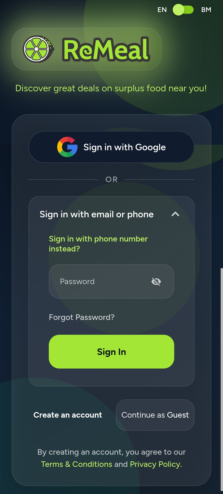

### Figure A2: Android location-permission choices

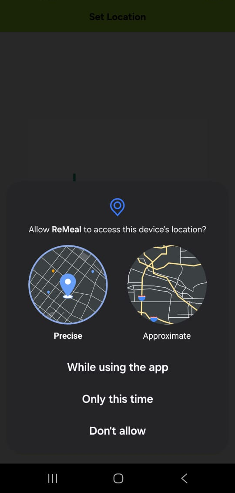

### Figure A3: Location screen offering current location or map selection

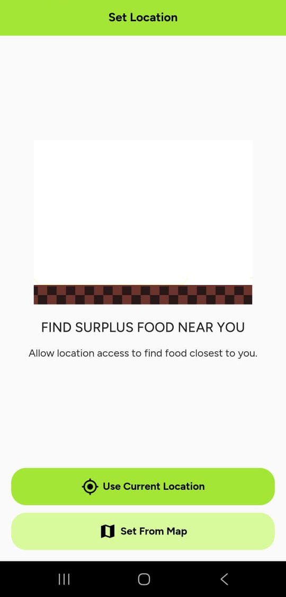

### Figure A4: Terms on registration and account deletion

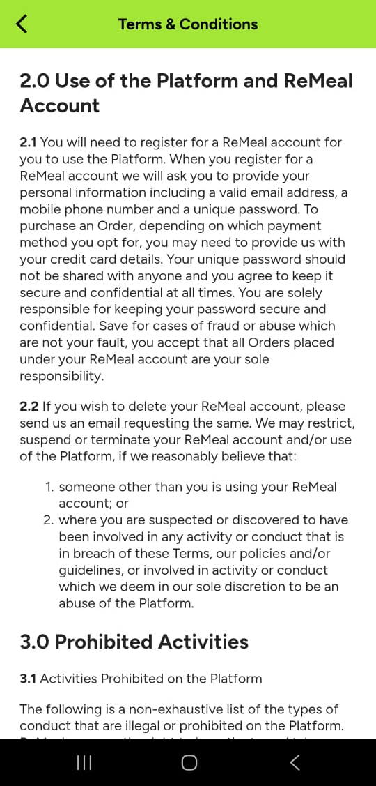

### Figure A5: Terms on acceptance and data processing

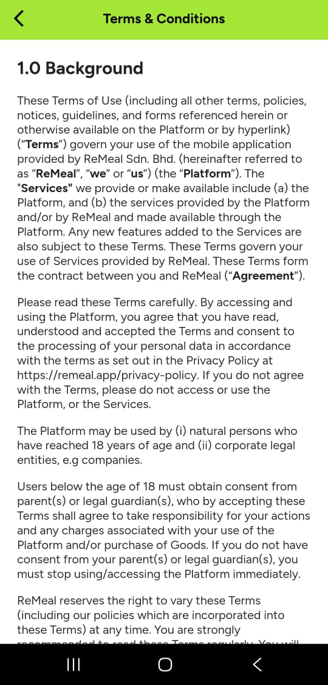

### Figure A6: Privacy Notice data-collection categories

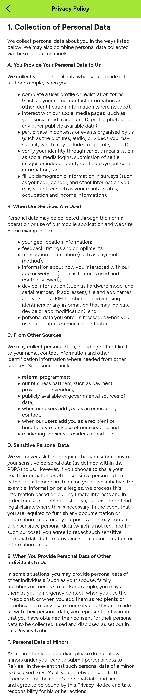

### Figure A7: Privacy Notice data disclosure and sharing

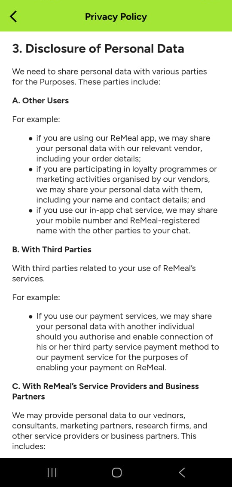

### Figure A8: Google Play Data safety label

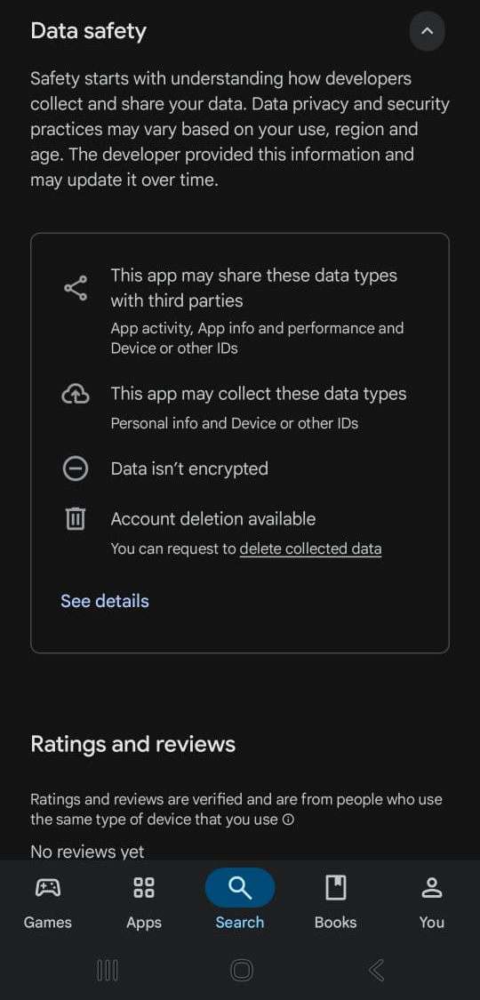

### Figure A9: Privacy Notice retention and international transfers

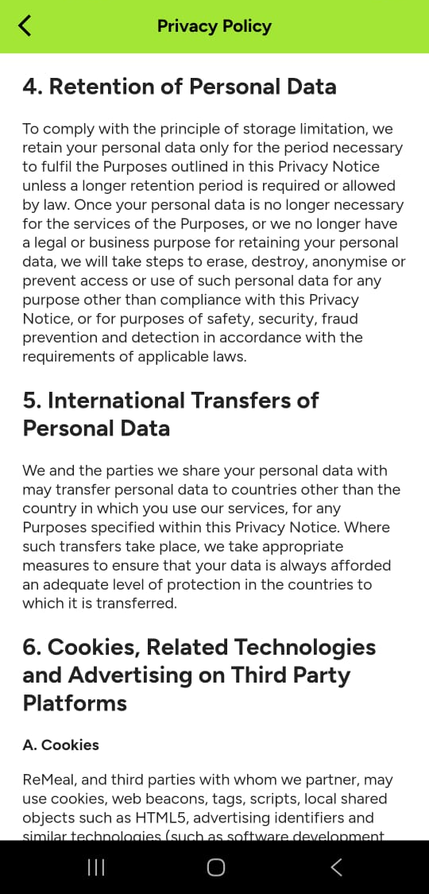

### Figure A10: Terms on allergens and location

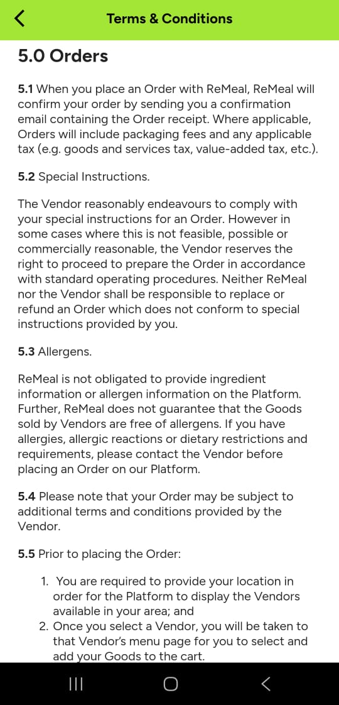

### Figure A11: Privacy Notice overview

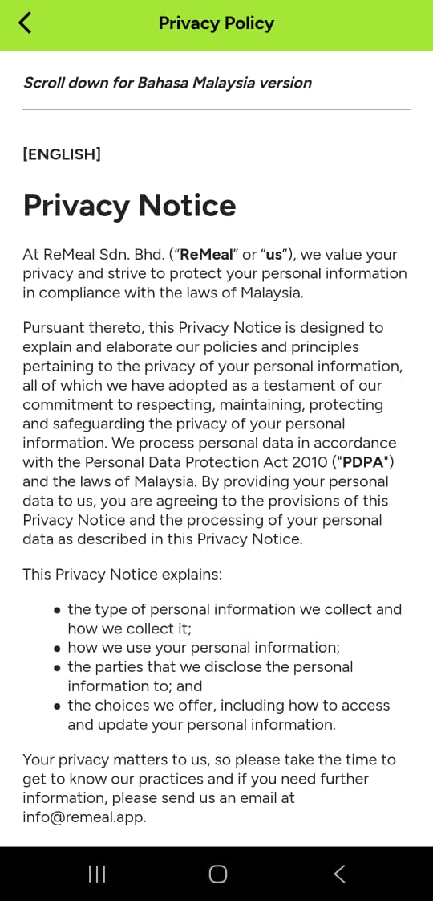

### Figure A12: “Use Default Location” screen and location-access banner

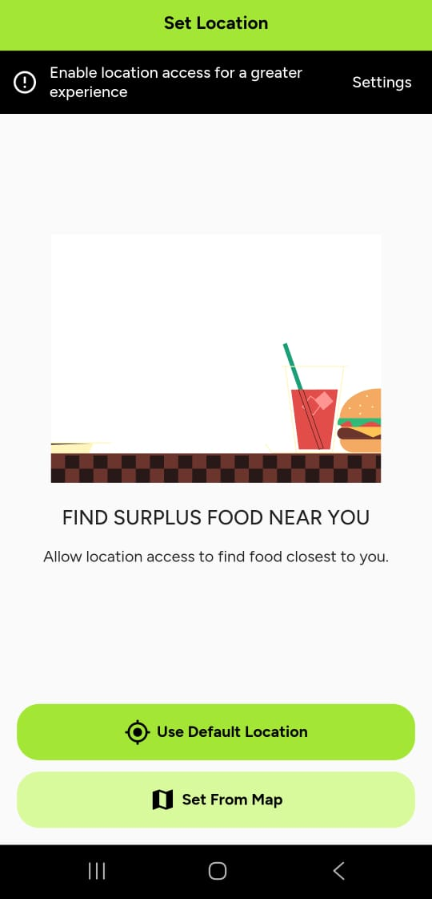

### Figure A13: Separate Android notification-permission prompt after opening the home screen

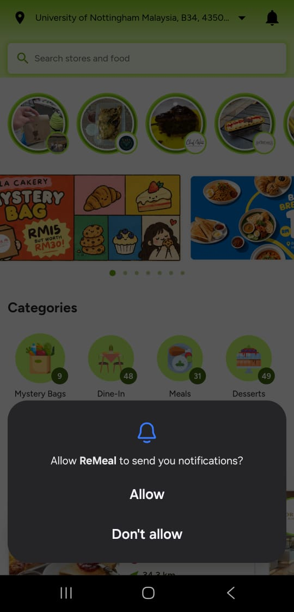

### Figure A14: Terms on Vendor's representations

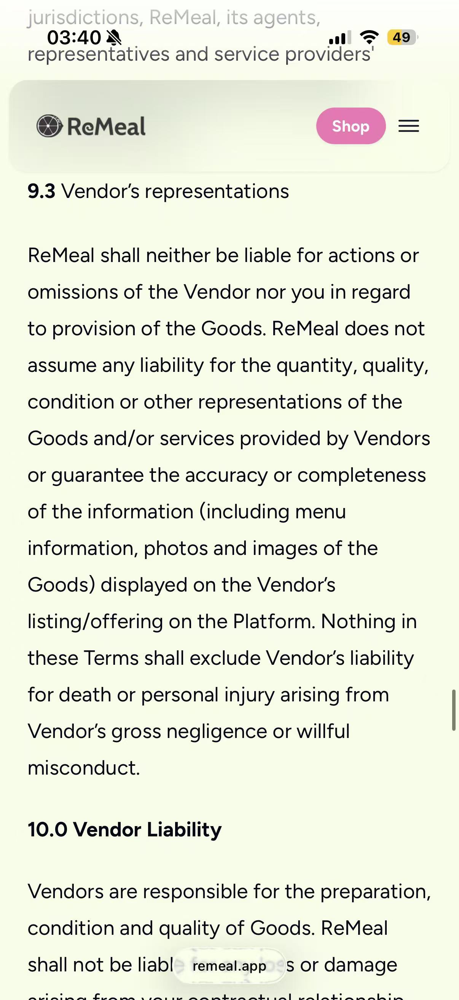
