# Appendix: Screenshot Evidence

[Back to the report](../README.md)

Use the index to find a figure, then expand **View screenshot** to see a centred preview. Phone screens are displayed at 360 pixels wide and policy pages at 440 pixels wide. Select the image or **Open full-size image** for the original resolution and browser zoom. Original image resolution is retained; Figure A19 has an opaque privacy redaction over the customer contact block.

| Evidence | Figures | Supports |
|---|---|---|
| Sign-in and initial location choices | [A1](#figure-a1-sign-in-and-account-consent-wording)–[A3](#figure-a3-initial-location-choices) | Privacy and consent |
| Account terms, privacy policies and Google Play label | [A4](#figure-a4-terms-on-registration-and-account-deletion)–[A11](#figure-a11-privacy-notice-overview) | Data collection, sharing and user choices |
| Default location and notifications | [A12](#figure-a12-default-location-option-and-location-access-banner)–[A13](#figure-a13-notification-permission-after-opening-the-home-screen) | Observed permission sequence |
| Vendor terms and refunds | [A14](#figure-a14-terms-on-vendors-representations)–[A15](#figure-a15-terms-on-cancellation-and-refunds) | Platform responsibilities and cancellation rules |
| App Store privacy summary | [A16](#figure-a16-apple-app-store-privacy-label-summary-view-developer-provided) | Developer-provided disclosures |
| Supplemental allergen example | [A17](#figure-a17-separate-listing-with-a-may-contain-traces-allergen-note) | An example outside Table 1 |
| Delivery cart and checkout | [A18](#figure-a18-remeal-delivery-cart)–[A20](#figure-a20-delivery-checkout-lower-section) | Prices, replacement options and visible warnings |
| Four sampled listings | [A21](#figure-a21-dorsett-40-off-buffet-breakfast-available-daily-listing)–[A24](#figure-a24-krem-waffle--eternal-series-listing) | Table 1 and food/allergen findings |

**Capture dates:** A1–A15 and A17: 2 November 2026, as recorded by the group. A16 and A18–A20: 3 November 2026. A21–A24: 1–3 November 2026, as recorded by the group. These images record displayed information, not independently verified vendor claims or backend behaviour.

### Figure A1: Sign-in and account-consent wording

The screen offers Google, email/phone and guest access. It says creating an account means agreeing to the Terms and Privacy Policy; no separate consent control is visible on this screen. The account form was not checked.

View screenshot A1

[Open full-size image](screenshots/01-app-sign-in-consent-guest.jpeg)

<a href="screenshots/01-app-sign-in-consent-guest.jpeg">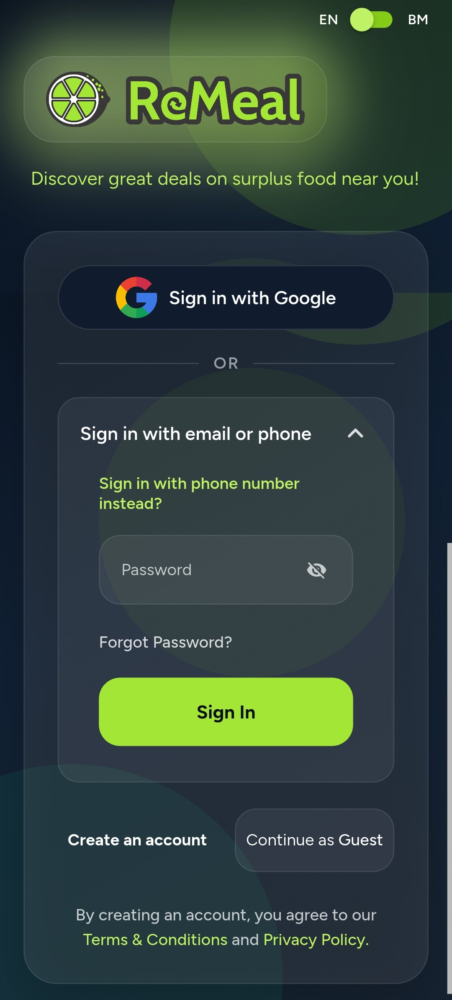</a>

### Figure A2: Android location-permission prompt

Android offers precise or approximate location and choices to allow while using the app, allow once or deny.

View screenshot A2

[Open full-size image](screenshots/02-app-location-permission.png)

<a href="screenshots/02-app-location-permission.png">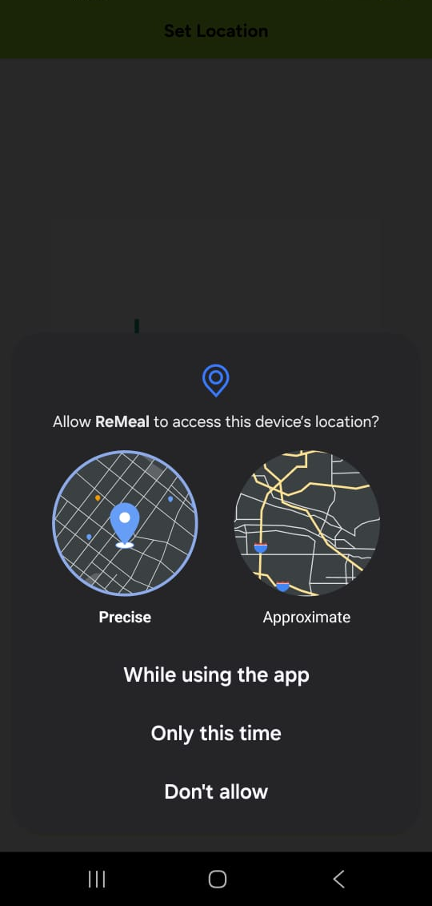</a>

### Figure A3: Initial location choices

The app offers “Use Current Location” and “Set From Map.” Selecting the map option triggered the Android prompt in Figure A2.

View screenshot A3

[Open full-size image](screenshots/03-app-set-location-options.png)

<a href="screenshots/03-app-set-location-options.png">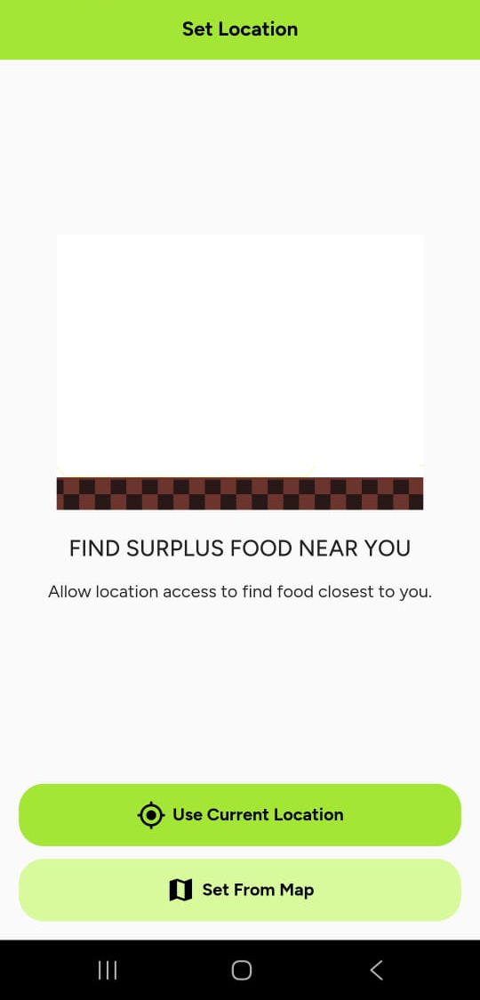</a>

### Figure A4: Terms on registration and account deletion

Sections 2.1–2.2 list email, mobile number and password for registration and direct account-deletion requests to email.

View screenshot A4

[Open full-size image](screenshots/05-terms-registration-account-deletion.png)

<a href="screenshots/05-terms-registration-account-deletion.png">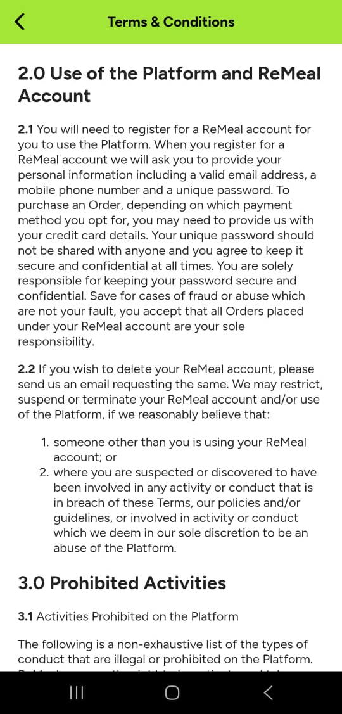</a>

### Figure A5: Terms on platform use and data processing

Section 1.0 treats access and use of the platform as agreement to the Terms and consent to processing under the Privacy Notice.

View screenshot A5

[Open full-size image](screenshots/06-terms-consent-background.png)

<a href="screenshots/06-terms-consent-background.png">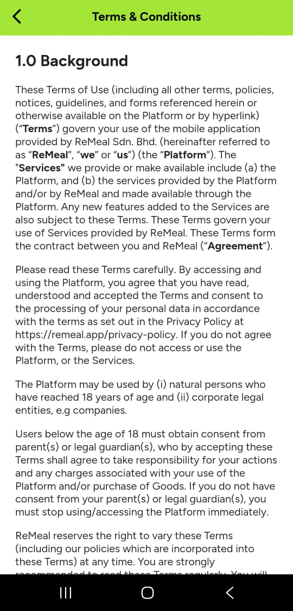</a>

### Figure A6: Privacy Notice data-collection categories

Section 1 lists contact details, location, transactions, app interactions, device information and messages. It also describes information from other sources and sensitive information users may choose to send, such as allergy details.

View screenshot A6

[Open full-size image](screenshots/13-privacy-data-collection-methods.jpeg)

<a href="screenshots/13-privacy-data-collection-methods.jpeg">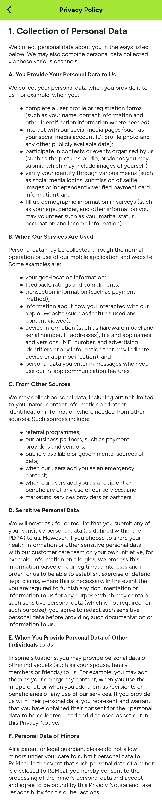</a>

### Figure A7: Privacy Notice data sharing

Section 3 describes sharing order details with vendors, contact details for vendor marketing, names and mobile numbers with chat partners, and data with service providers or business partners.

View screenshot A7

[Open full-size image](screenshots/08-privacy-data-disclosure.png)

<a href="screenshots/08-privacy-data-disclosure.png">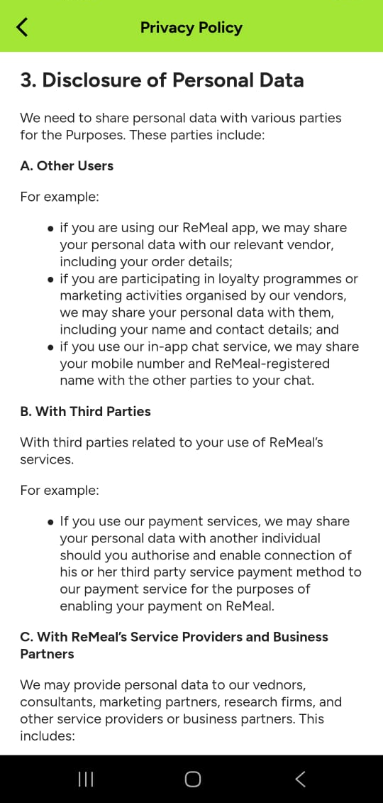</a>

### Figure A8: Google Play Data safety label

The developer-provided label lists personal information and device IDs as collected, app activity and device IDs as shared, and says data “isn’t encrypted.” Google defines this field as encryption in transit; it is not an independent audit.

View screenshot A8

[Open full-size image](screenshots/09-google-play-data-safety.png)

<a href="screenshots/09-google-play-data-safety.png">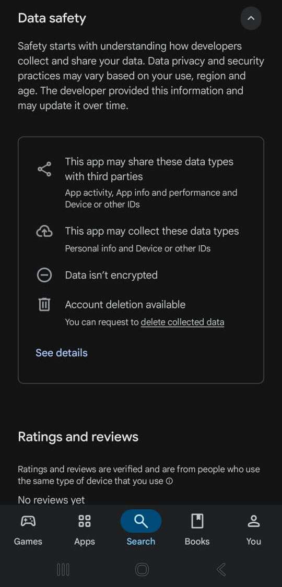</a>

### Figure A9: Privacy Notice retention and international transfers

Sections 4–5 describe retention for stated purposes and possible overseas data transfers.

View screenshot A9

[Open full-size image](screenshots/07-privacy-retention-international-transfers.png)

<a href="screenshots/07-privacy-retention-international-transfers.png">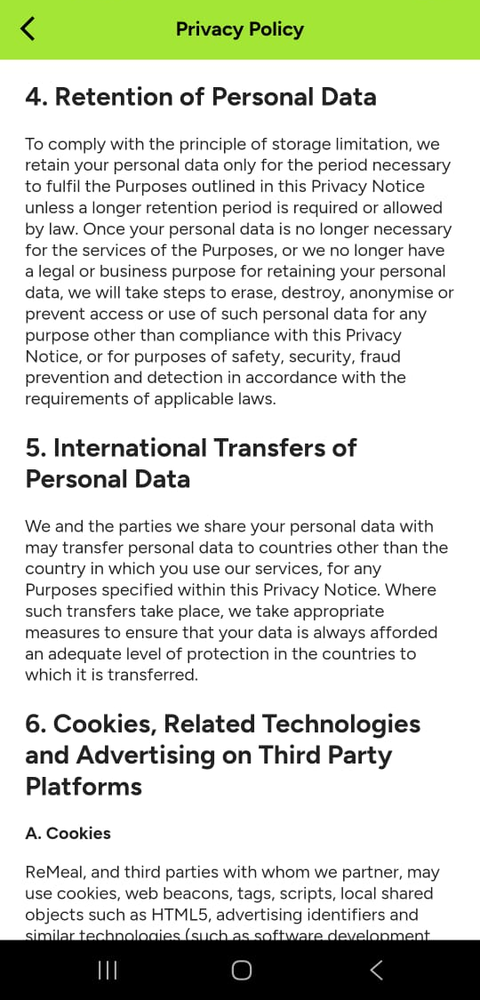</a>

### Figure A10: Terms on allergens and required location information

Sections 5.3 and 5.5 disclaim a duty to provide allergen information and say a location is required to show nearby vendors.

View screenshot A10

[Open full-size image](screenshots/10-terms-allergens-location.png)

<a href="screenshots/10-terms-allergens-location.png">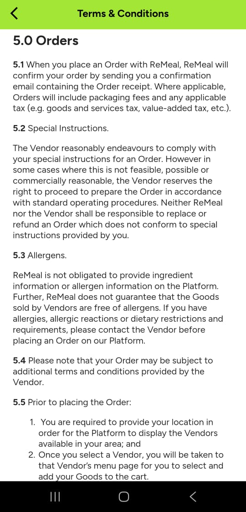</a>

### Figure A11: Privacy Notice overview

The notice says that providing personal data means agreeing to its processing as described.

View screenshot A11

[Open full-size image](screenshots/12-privacy-notice-overview.png)

<a href="screenshots/12-privacy-notice-overview.png">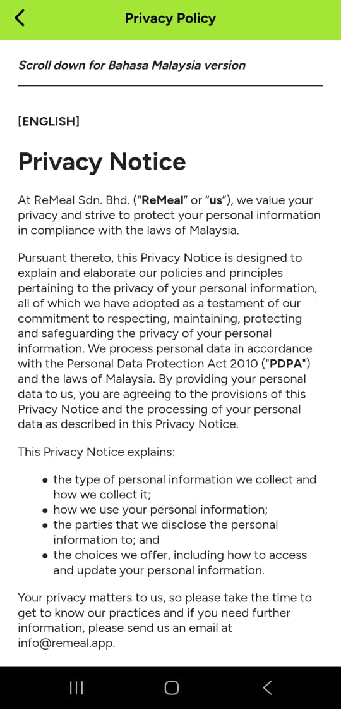</a>

### Figure A12: Default-location option and location-access banner

After backing out of the location prompt, the screen showed “Use Default Location” and a banner saying location access provides a “greater experience.” The home screen was reachable without granting device access; ordering from the default was not tested.

View screenshot A12

[Open full-size image](screenshots/12-app-default-location-banner.png)

<a href="screenshots/12-app-default-location-banner.png">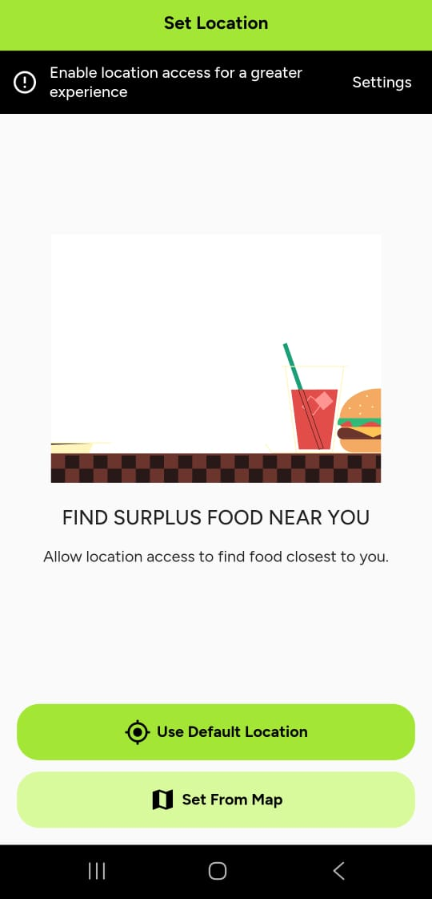</a>

### Figure A13: Notification permission after opening the home screen

A separate notification-permission prompt appeared after the home screen opened.

View screenshot A13

[Open full-size image](screenshots/13-app-notification-permission.png)

<a href="screenshots/13-app-notification-permission.png">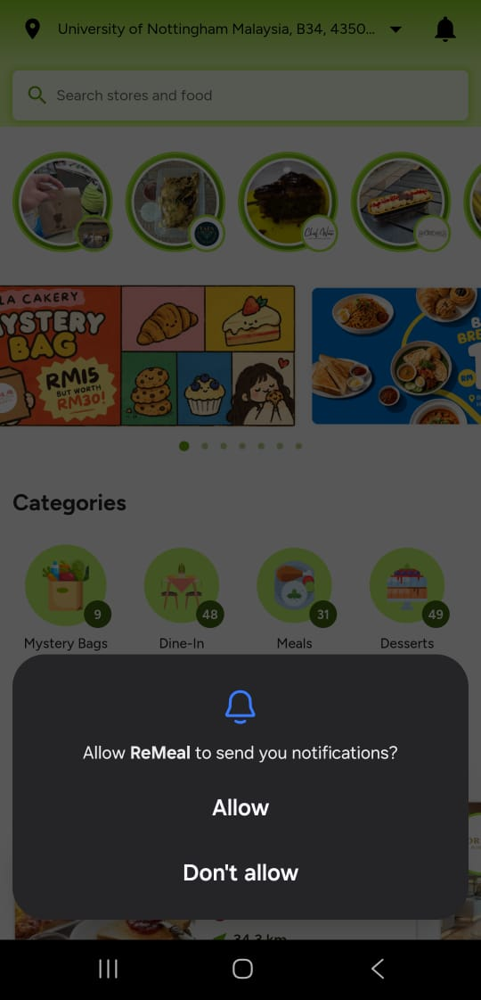</a>

### Figure A14: Terms on Vendor's representations

Section 9.3 addresses representations and responsibilities relating to vendor goods and listings.

View screenshot A14

[Open full-size image](screenshots/14-terms-vender-representations.jpg)

<a href="screenshots/14-terms-vender-representations.jpg">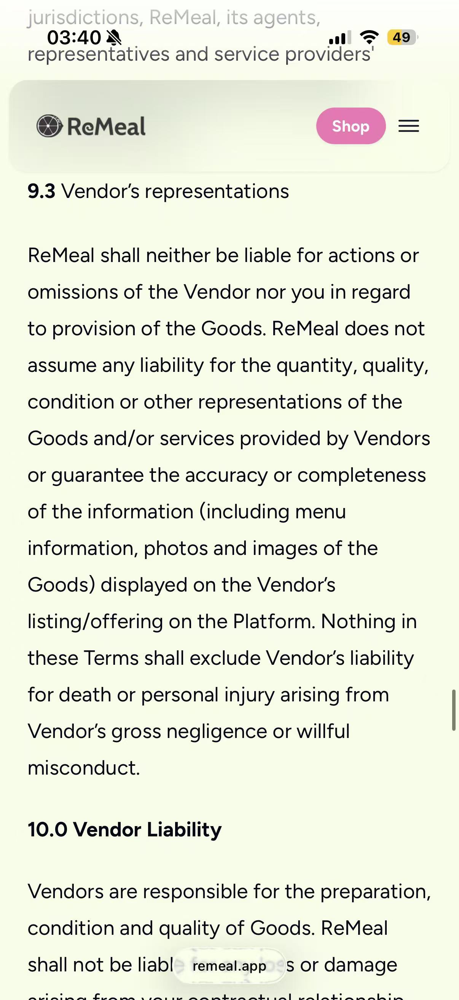</a>

### Figure A15: Terms on cancellation and refunds

Sections 5.7–5.8 allow customer cancellation before vendor acceptance and deny refunds for customer cancellation after acceptance.

View screenshot A15

[Open full-size image](screenshots/15-terms-cancellation-refunds.png)

### Figure A16: Apple App Store privacy label, summary view (developer-provided)

Captured 3 November 2026 from the Malaysian App Store listing for ReMeal (Apple App Store, n.d.). The summary lists Purchases, Location, Contact Info, Identifiers and Usage Data as data that may be linked to users, and Diagnostics as data that may be collected without being linked.

View screenshot A16

[Open full-size image](screenshots/16-app-store-privacy-label.jpeg)

### Figure A17: Separate listing with a “may contain traces” allergen note

This separate Sunset Terrace listing displays a “may contain traces” note. It is not part of the four-offer sample in Table 1.

View screenshot A17

[Open full-size image](screenshots/17-supplemental-listing-allergen-note.png)

### Figure A18: ReMeal delivery cart

The cart shows one Fried Kuey Teow from Palms Café, Putrajaya, priced at RM16.00. It displays the item quantity, discount and an option to proceed to checkout. No refund or cancellation information is visible on this screen.

View screenshot A18

[Open full-size image](screenshots/18-delivery-cart.png)

<a href="screenshots/18-delivery-cart.png">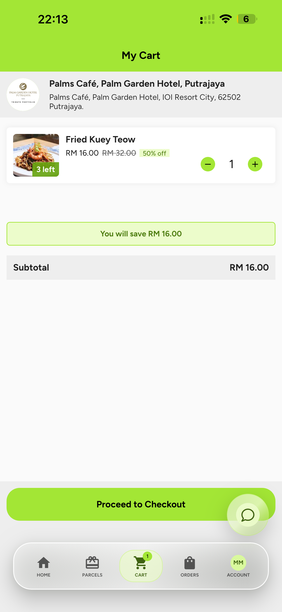</a>

### Figure A19: Delivery checkout (upper section)

The checkout screen shows the delivery option, rider collection time, delivery-address section and GrabExpress delivery fee of RM13.55. The customer contact details have been covered with a solid block. No refund or cancellation warning is visible in this section.

View screenshot A19

[Open full-size image](screenshots/19-checkout-top.png)

<a href="screenshots/19-checkout-top.png">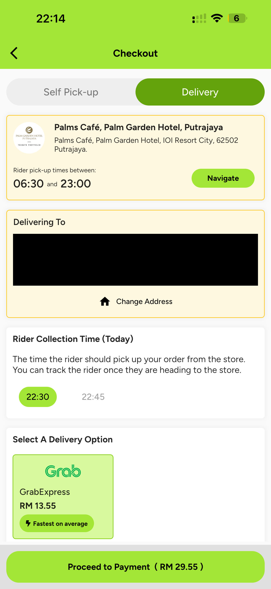</a>

### Figure A20: Delivery checkout (lower section)

The checkout shows an out-of-stock option set to "Replace with alternative if available" by default. It also includes a notes field, subtotal, delivery fee and total of RM29.55. No refund or cancellation warning is visible before the "Proceed to Payment" button. We did not enter the payment stage or place an order.

View screenshot A20

[Open full-size image](screenshots/20-checkout-bottom.png)

<a href="screenshots/20-checkout-bottom.png">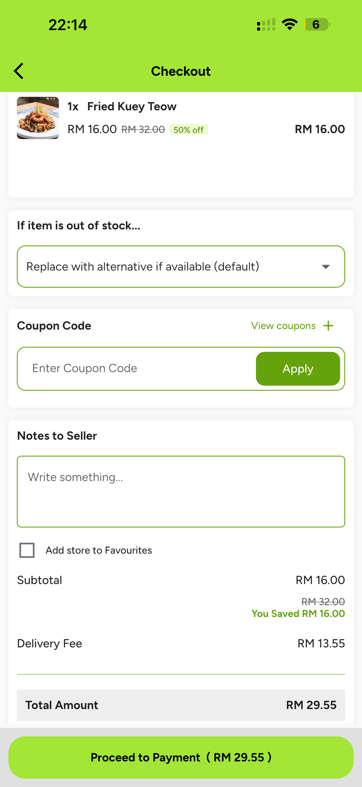</a>

### Figure A21: Dorsett 40% OFF Buffet Breakfast (Available Daily) listing

The listing describes the buffet as offering local and international dishes and a children’s menu, but names no dishes and gives no ingredient or allergen information.

View screenshot A21

[Open full-size image](screenshots/21-Dorsett-Buffet-Breakfast.jpg)

<a href="screenshots/21-Dorsett-Buffet-Breakfast.jpg">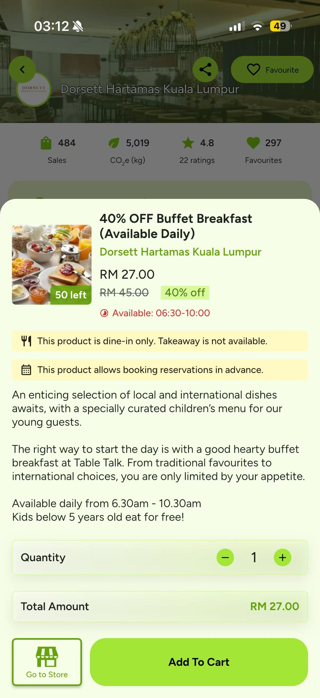</a>

### Figure A22: Dorsett 50% OFF Weekend Buffet Hi-tea (Saturdays) listing

The listing describes a spread of local favourites and international flavours but names no dishes and gives no ingredient or allergen information.

View screenshot A22

[Open full-size image](screenshots/22-Dorsett-Weekend-Buffet-Hi-tea.jpg)

<a href="screenshots/22-Dorsett-Weekend-Buffet-Hi-tea.jpg">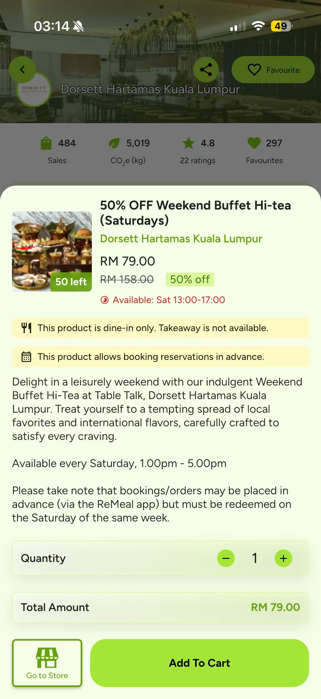</a>

### Figure A23: Krem Mystery Single Scoop - Eternal Series listing

The listing names four possible flavours and states “Contains dairy.” It does not identify the flavour supplied or provide a scoop size or information about other allergens.

View screenshot A23

[Open full-size image](screenshots/23-Krem-Tarik-Mystery-Single-Scoop.jpg)

<a href="screenshots/23-Krem-Tarik-Mystery-Single-Scoop.jpg">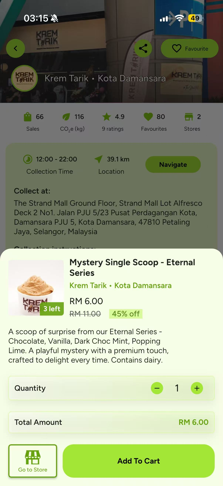</a>

### Figure A24: Krem Waffle + Eternal Series listing

The listing describes one golden waffle served with a mystery scoop from four possible flavours and states “Contains dairy.” It does not specify the waffle’s contents or ingredients, the flavour supplied, or information about other allergens.

View screenshot A24

[Open full-size image](screenshots/24-Krem-Tarik-Waffle.jpg)

<a href="screenshots/24-Krem-Tarik-Waffle.jpg">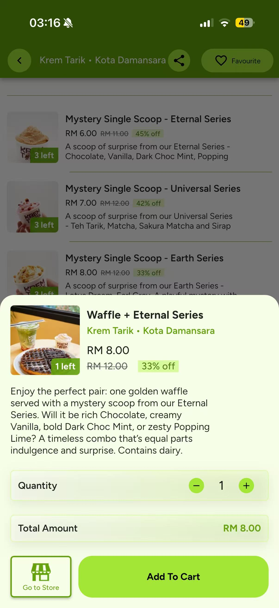</a>

## Evidence limitations

We didn't inspect network traffic, servers or vendor systems; explicitly deny location permission; test whether the location banner returns; or test ordering from the default location. The home screen showed University of Nottingham Malaysia, but we could not establish how that default was selected. The account-creation form was not opened. The app-store disclosures are developer-supplied.
