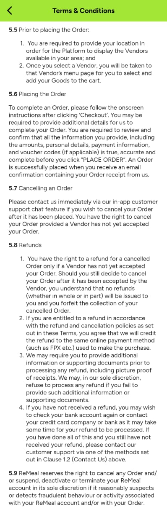
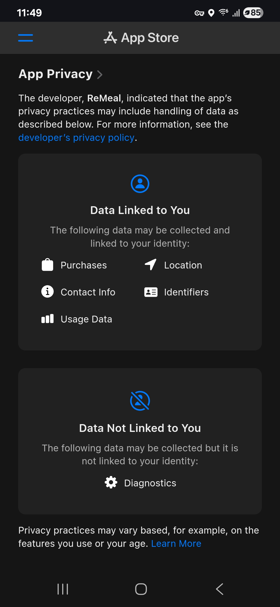
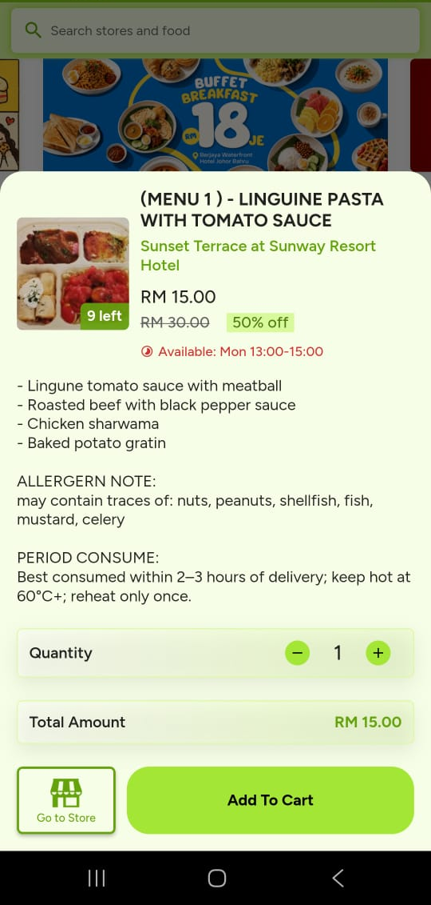

# Appendix: Screenshot Evidence

[Back to the report](../README.md)

Figures A1–A17 document the Android walkthrough, policy pages and three supplemental screens. App and policy screenshots were captured on 2 November 2026, except the App Store summary in Figure A16, captured on 3 November 2026. Figure A17 is a separate food listing, outside the four offers in Table 1. Screenshots record displayed information; they do not verify backend data flows, vendor practices or store claims.

### Figure A1: Sign-in and account-consent wording

The screen offers Google, email/phone and guest access. It says creating an account means agreeing to the Terms and Privacy Policy; no separate consent control is visible on this screen. The account form was not checked.

### Figure A2: Android location-permission prompt

Android offers precise or approximate location and choices to allow while using the app, allow once or deny.

### Figure A3: Initial location choices

The app offers “Use Current Location” and “Set From Map.” Selecting the map option triggered the Android prompt in Figure A2.

### Figure A4: Terms on registration and account deletion

Sections 2.1–2.2 list email, mobile number and password for registration and direct account-deletion requests to email.

### Figure A5: Terms on platform use and data processing

Section 1.0 treats access and use of the platform as agreement to the Terms and consent to processing under the Privacy Notice.

### Figure A6: Privacy Notice data-collection categories

Section 1 lists contact details, location, transactions, app interactions, device information and messages. It also describes information from other sources and sensitive information users may choose to send, such as allergy details.

### Figure A7: Privacy Notice data sharing

Section 3 describes sharing order details with vendors, contact details for vendor marketing, names and mobile numbers with chat partners, and data with service providers or business partners.

### Figure A8: Google Play Data safety label

The developer-provided label lists personal information and device IDs as collected, app activity and device IDs as shared, and says data “isn’t encrypted.” Google defines this field as encryption in transit; it is not an independent audit.

### Figure A9: Privacy Notice retention and international transfers

Sections 4–5 describe retention for stated purposes and possible overseas data transfers.

### Figure A10: Terms on allergens and required location information

Sections 5.3 and 5.5 disclaim a duty to provide allergen information and say a location is required to show nearby vendors.

### Figure A11: Privacy Notice overview

The notice says that providing personal data means agreeing to its processing as described.

### Figure A12: Default-location option and location-access banner

After backing out of the location prompt, the screen showed “Use Default Location” and a banner saying location access provides a “greater experience.” The home screen was reachable without granting device access; ordering from the default was not tested.

### Figure A13: Notification permission after opening the home screen

A separate notification-permission prompt appeared after the home screen opened.

### Figure A14: Terms on Vendor's representations

Section 9.3 addresses representations and responsibilities relating to vendor goods and listings.

### Figure A15: Terms on cancellation and refunds

Sections 5.7–5.8 allow customer cancellation before vendor acceptance and deny refunds for customer cancellation after acceptance.

### Figure A16: Apple App Store privacy label, summary view (developer-provided)

Captured 3 November 2026 from the Malaysian App Store listing for ReMeal (Apple App Store, n.d.). The summary lists Purchases, Location, Contact Info, Identifiers and Usage Data as data that may be linked to users, and Diagnostics as data that may be collected without being linked.

### Figure A17: Separate listing with a “may contain traces” allergen note

This separate Sunset Terrace listing displays a “may contain traces” note. It is not part of the four-offer sample in Table 1.

We did not inspect network traffic, servers or vendor systems; explicitly deny location permission; test whether the location banner returns; or test ordering from the default location. The home screen showed University of Nottingham Malaysia, but we did not establish how that default was selected. The account-creation form was not opened. The app-store disclosures are developer-supplied.
